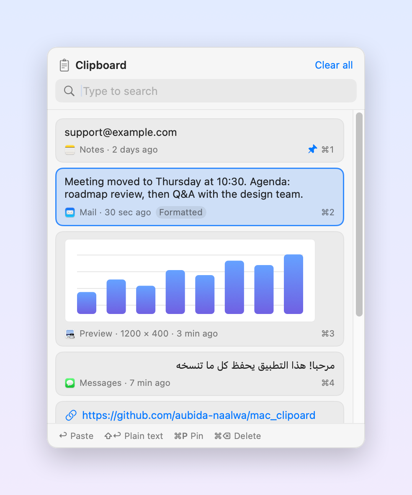

# ClipHistory

Clipboard history for macOS that works like Windows' **Win + V**. Press **⇧⌘V** anywhere, pick
something you copied earlier, and it's pasted right where you're typing.

<p align="center">
  <picture>
    <source media="(prefers-color-scheme: dark)" srcset="docs/screenshot-dark.png">
    
  </picture>
</p>

## Features

- **Remembers everything you copy:** text, formatted text, links, images and files from Finder.
  Formatting is kept when you paste.
- **Opens where you type:** the panel appears under your text cursor, or at the mouse pointer when
  the app doesn't report the cursor's position.
- **Search:** start typing to filter your history.
- **Pin items:** pinned items stay at the top and are kept when you clear the history.
- **Right-to-left text:** Arabic and Hebrew are shown right-aligned.
- **Private:** history stays on your Mac, and passwords copied from password managers are never saved.
- **Out of the way:** lives in the menu bar, with no Dock icon.

## Install

You need macOS 13 or later and the Xcode Command Line Tools (`xcode-select --install`).

```bash
git clone https://github.com/aubida-naalwa/mac_clipoard.git
cd mac_clipoard
scripts/setup-signing.sh   # one time: creates a local signing certificate
make install               # builds, copies to /Applications and opens it
```

If macOS asks for your login password during `make install`, enter it and choose **Always Allow**.
This lets `codesign` use the certificate.

When ClipHistory opens for the first time:

1. Keep **Open ClipHistory at login** ticked, so the shortcut works after you restart your Mac.
2. Click **Allow Accessibility…** and turn on **ClipHistory** in System Settings → Privacy & Security
   → Accessibility. This permission lets ClipHistory paste for you.

A clipboard icon appears in the menu bar while ClipHistory is running.

## How to use

1. **Copy as usual** with ⌘C. ClipHistory saves each copy in the background.
2. **Click where you want to paste**, for example a chat box, a document or an email.
3. **Press ⇧⌘V.** Your history opens with the newest items at the top.
4. **Pick an item:** click it, select it with ↑ ↓ and press Return, or press ⌘1 to ⌘9.
   It's pasted where your cursor was.

Plain ⌘V still pastes your latest copy as usual. Use ⇧⌘V to reach older ones.

### Keys in the panel

| Key | Action |
| --- | --- |
| ↑ ↓ | Move the selection |
| ↩ | Paste |
| ⇧↩ or ⌥↩ | Paste as plain text, without formatting |
| ⌘1 … ⌘9 | Paste item 1 to 9 |
| ⌘P | Pin or unpin the selected item |
| ⌘⌫ | Delete the selected item |
| Type | Search |
| Esc | Clear the search, then close the panel |

With the mouse, hover over an item to show its pin and delete buttons, or right-click it for more
options. **Clear all** removes everything except pinned items.

### Menu bar options

Click the clipboard icon in the menu bar:

| Option | What it does |
| --- | --- |
| Show Clipboard History | Opens the panel |
| Pause Recording | Stops saving copies until you turn it off |
| Clear History | Removes everything except pinned items |
| Shortcut | Changes the shortcut to ⌥⌘V, ⌃⌘V or ⌃⌥V |
| History Size | Keeps 25, 50, 100 or 200 items (pinned items don't count) |
| Open at Login | Starts ClipHistory when you log in |

## Privacy

- History is stored only on your Mac, in `~/Library/Application Support/ClipHistory/`.
  ClipHistory makes no network connections.
- Content that password managers mark as concealed (1Password, Bitwarden, KeePassXC and others) is
  never saved.
- Use **Pause Recording** before copying anything else you don't want kept.

## Troubleshooting

**⇧⌘V does nothing.** Look for the clipboard icon in the menu bar. If it isn't there, ClipHistory
isn't running: open it from Applications and turn on **Open at Login**. If the icon is there, another
app may already use ⇧⌘V. Pick a different shortcut from the menu bar icon → **Shortcut**.

**It keeps asking for Accessibility, but the switch is already on.** macOS ties the permission to
the app's signature, and the switch can belong to an older build. Open System Settings → Privacy &
Security → Accessibility, select ClipHistory, click **−**, then click **+** and add
`/Applications/ClipHistory.app` again. Build with `scripts/setup-signing.sh` in place so later
rebuilds keep the permission.

**The item is copied but not pasted.** ClipHistory doesn't have Accessibility access yet. Press ⌘V
yourself, or grant access as described above.

## Uninstall

```bash
pkill -x ClipHistory
rm -rf /Applications/ClipHistory.app "$HOME/Library/Application Support/ClipHistory"
defaults delete app.cliphistory.ClipHistory
```

Then remove ClipHistory from System Settings → Privacy & Security → Accessibility and from
System Settings → General → Login Items. To remove the signing certificate, open Keychain Access
and delete **ClipHistory Local Signing** from the login keychain.

## Development

```bash
make app       # builds build/ClipHistory.app
make run       # builds and opens it from the build folder
make install   # builds, copies to /Applications and opens it
make icon      # regenerates Resources/AppIcon.icns
```

`scripts/build-app.sh` signs with the **ClipHistory Local Signing** certificate when it exists, and
falls back to ad-hoc signing otherwise. Ad-hoc builds lose the Accessibility permission on every
rebuild. To sign with another identity, run
`SIGN_IDENTITY="Apple Development: you@example.com (TEAMID)" make app`.

| File | Purpose |
| --- | --- |
| `Sources/ClipHistory/AppDelegate.swift` | App startup, menu bar menu, pasting |
| `Sources/ClipHistory/ClipboardMonitor.swift` | Watches the clipboard and reads each copy |
| `Sources/ClipHistory/HistoryStore.swift` | Saves history and puts items back on the clipboard |
| `Sources/ClipHistory/PanelController.swift` | The floating panel, its placement and keyboard handling |
| `Sources/ClipHistory/HistoryView.swift` | The panel's SwiftUI interface |
| `Sources/ClipHistory/HotKey.swift` | The global shortcut |
| `Sources/ClipHistory/Paster.swift` | Sends ⌘V and finds the text cursor |
